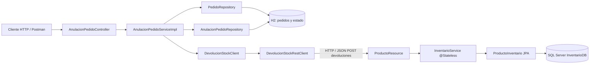

# Diagrama de arquitectura PA2

La transacción Spring controla las escrituras locales en H2. Inventario administra su propia transacción en SQL Server. No existe una transacción distribuida atómica entre ambos sistemas.
